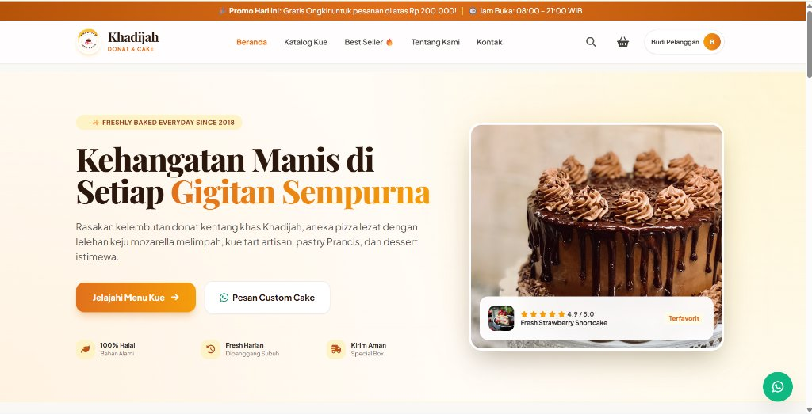

# Khadijah Donat & Cake

Website e-commerce toko kue **Khadijah Donat & Cake** berbasis Laravel 10 untuk pemesanan aneka donat kentang, pizza, kue ulang tahun custom, pastry, dan kue tradisional secara online.

## Tampilan Halaman Beranda



## Fitur Utama

### Pelanggan
- **Beranda Interaktif** — Menampilkan kategori favorit, menu *best seller*, promo *custom cake*, keunggulan dapur, testimoni pelanggan, dan animasi *scroll reveal*.
- **Katalog & Detail Produk** — Pencarian produk, filter kategori, pilihan varian ukuran, serta informasi stok dan rating.
- **Keranjang Belanja** — Mendukung pengguna login maupun *guest session*.
- **Checkout & Pembayaran** — Integrasi **Midtrans** (`midtrans/midtrans-php`) beserta *webhook callback*, serta dukungan upload bukti pembayaran.
- **Riwayat Pesanan & Profil** — Pelanggan dapat memantau status pesanan dan mengelola profil akun.

### Admin Panel (`/admin`)
- **Dashboard Admin** — Ringkasan operasional toko.
- **Manajemen Produk & Kategori** — Tambah, ubah, dan hapus produk beserta kategorinya.
- **Manajemen Pesanan** — Pembaruan status pesanan dan verifikasi pembayaran pelanggan.

## Teknologi yang Digunakan

- **Backend:** PHP `^8.1`, Laravel `^10.0`, Laravel Breeze, Laravel Sanctum
- **Frontend:** Blade Templates, Tailwind CSS, Alpine.js, Vite
- **Database:** MySQL
- **Payment Gateway:** Midtrans PHP SDK (`^2.6`)

## Cara Menjalankan Secara Lokal

1. **Clone repository**
   ```bash
   git clone https://github.com/aplannst41/website-toko-kue-Khadijah.git
   cd website-toko-kue-Khadijah
   ```

2. **Install dependencies**
   ```bash
   composer install
   npm install
   ```

3. **Konfigurasi environment**
   ```bash
   cp .env.example .env
   ```
   Sesuaikan konfigurasi database (`DB_DATABASE`, `DB_USERNAME`, `DB_PASSWORD`) dan kredensial Midtrans di file `.env`.

4. **Generate application key & storage link**
   ```bash
   php artisan key:generate
   php artisan storage:link
   ```

5. **Migrasi database**
   ```bash
   php artisan migrate
   ```

6. **Build aset & jalankan server**
   ```bash
   npm run build
   php artisan serve
   ```
   Buka `http://127.0.0.1:8000` di browser.

## Informasi Toko

- **Nama:** Khadijah Donat & Cake
- **Alamat:** Jl. Paya Billi - Panggoi Road, Panggoi, Kec. Muara Dua, Kota Lhokseumawe, Aceh
- **Jam Operasional:** Setiap Hari, 08:00 – 21:00 WIB

## Lisensi

Proyek ini menggunakan lisensi [MIT](https://opensource.org/licenses/MIT).
